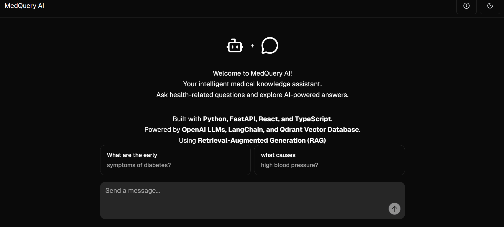
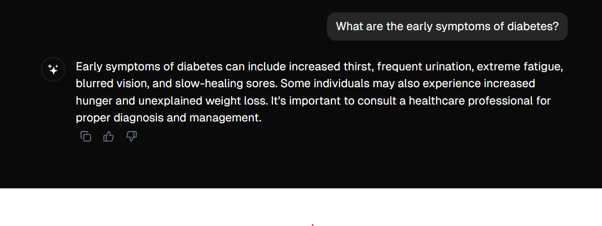
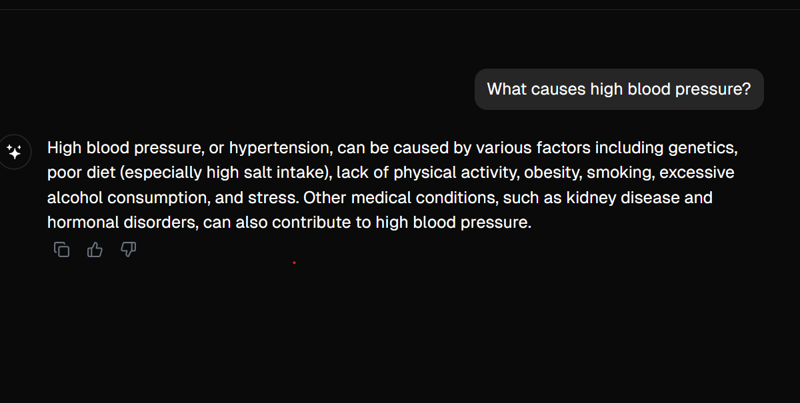
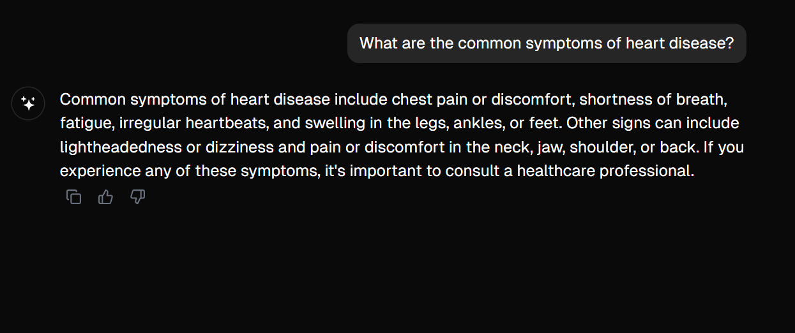
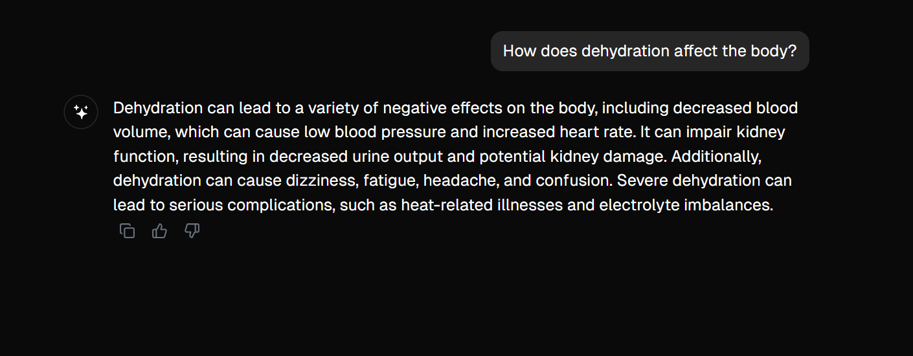
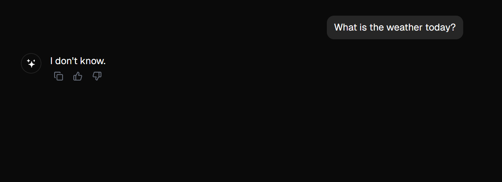

# 🩺 MedQuery AI – Medical RAG Chatbot 🚀


---

## 🌐 MedQuery AI – Intelligent Medical Assistant

**MedQuery AI** is a full-stack AI-powered medical chatbot designed to answer health-related questions using **Retrieval-Augmented Generation (RAG)**.

The application combines OpenAI language models, LangChain, and the Qdrant vector database to retrieve relevant medical information and generate clear, context-aware responses.

This project demonstrates my skills in **Python, FastAPI, React, TypeScript, Generative AI, and RAG-based application development**.

## ✨ Key Features

- 🩺 **Medical Question Answering** – Ask health-related questions through an interactive chatbot.
- 🧠 **AI-Powered Responses** – Generate natural-language answers using OpenAI.
- 🔍 **Semantic Search** – Retrieve relevant medical information using Qdrant.
- 📚 **Retrieval-Augmented Generation** – Combine medical knowledge retrieval with LLM-generated responses.
- ⚡ **FastAPI Backend** – Handle requests and AI processing.
- 💻 **Responsive Interface** – Modern chatbot built with React and TypeScript.
- 🔗 **LangChain Integration** – Manage retrieval and question-answering workflows.

## 🛠️ Technologies Used

| Frontend | Backend | AI & Database |
|---|---|---|
| React | Python | OpenAI API |
| TypeScript | FastAPI | LangChain |
| Vite | Poetry | Qdrant |
| Radix UI | | MedQuAD Dataset |

## 📂 Project Structure

```text
medquery-ai/
│
├── backend/
│   ├── app/
│   │   ├── api/             # API endpoints
│   │   └── core/            # Application configuration
│   ├── main.py              # Backend entry point
│   └── pyproject.toml       # Python dependencies
│
├── ragbot/
│   ├── public/              # Static assets and icons
│   ├── src/
│   │   ├── components/      # Reusable UI components
│   │   └── pages/           # Chatbot pages
│   ├── index.html           # HTML entry point
│   └── package.json         # Frontend dependencies
│
├── docs/
│   └── images/              # Project screenshots
│
└── README.md                # Project documentation
```

## ⚙️ Installation & Setup

Follow these steps to run MedQuery AI locally.

### 1️⃣ Clone the Repository

```bash
git clone https://github.com/YOUR-USERNAME/medquery-ai.git
cd medquery-ai
```

Replace `YOUR-USERNAME` with your GitHub username.

### 2️⃣ Install Backend Dependencies

```bash
cd backend
poetry install
```

Configure the backend `.env` file with your OpenAI API key and required database settings.

### 3️⃣ Start the Backend Server

Ensure your configured database services, including Qdrant, are running and the medical knowledge base has been populated.

```bash
poetry run python main.py
```

Backend API:

`http://127.0.0.1:8000`

Swagger API documentation:

`http://127.0.0.1:8000/docs`

### 4️⃣ Install Frontend Dependencies

Open a new terminal:

```bash
cd ragbot
pnpm install
```

Create or update `ragbot/.env`:

```env
VITE_PUBLIC_API_URL=http://127.0.0.1:8000
VITE_STREAMING_SUPPORT=yes
```

### 5️⃣ Run the Frontend

```bash
pnpm run dev -- --host 127.0.0.1 --port 3000
```

Open your browser:

`http://127.0.0.1:3000`

## 🧠 How MedQuery AI Works

```text
User asks a medical question
           │
           ▼
    React Frontend
           │
           ▼
    FastAPI Backend
           │
           ▼
   LangChain RAG Pipeline
           │
           ▼
  Qdrant Vector Database
           │
           ▼
  Relevant Medical Context
           │
           ▼
      OpenAI LLM
           │
           ▼
  AI-Generated Response
```

## 📸 Project Screenshots

### 🏠 Landing Page



### 💬 Medical Question Answering
 what are the early symptoms of diabetes?


what causes high blood pressure?



### 

### 🩺 Additional Chatbot Example

what are the common symptoms of heart disease?


How does dehydration affect the body?


### Test Question

what is the weather today?



## 💬 Example Questions

Users can ask questions such as:

- What are the early symptoms of diabetes?
- What causes diabetes?
- How can I control my blood sugar?
- What causes high blood pressure?
- What are the benefits of regular exercise?

## 🚀 Future Enhancements

- Add persistent conversation history.
- Improve retrieval accuracy.
- Expand the medical knowledge base.
- Display supporting medical sources alongside answers.
- Improve the chatbot's user experience.

## ⚠️ Medical Disclaimer

MedQuery AI is developed for educational and demonstration purposes. The chatbot provides general medical information and is not a substitute for professional medical advice, diagnosis, or treatment.

---

### 👨‍💻 Project Highlights

**MedQuery AI** demonstrates practical experience in:

- Full-stack application development
- REST API development with FastAPI
- React and TypeScript frontend development
- Generative AI and prompt engineering
- Retrieval-Augmented Generation (RAG)
- Vector databases and semantic search

**Built with Python, FastAPI, React, TypeScript, OpenAI, LangChain, and Qdrant.**

## 📬 Contact & Connect

I'm open to opportunities in **Python Development, Full-Stack Development, and Generative AI**.

Feel free to connect with me for professional opportunities, project discussions, or collaborations.

📧 **Email:** [raghava.m1001@gmail.com](mailto:raghava.m1001@gmail.com)

📞   **Phone:**[+1 972-383-9611]

💼 **LinkedIn:** [Connect on LinkedIn](https://www.linkedin.com/in/raghava-m1001/)

🐙 **GitHub:** [Explore My Projects](https://github.com/Raghav-1303/)

🌐 **Portfolio:** [Visit My Portfolio](https://raghav-1303.github.io/)

---

### ⭐ Support This Project

If you find **MedQuery AI** useful, consider giving the repository a ⭐ on GitHub!

**Built with ❤️ using Python, FastAPI, React, OpenAI, LangChain, and Qdrant.**

